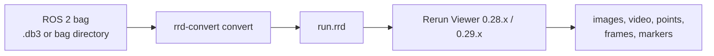

# rrd-convert

**go from any bag to Rerun**

One command turns a ROS 2 bag into a recording you can open in the Rerun Viewer. Standard sensors, TF, and markers are built in. A custom message is a field-to-shape mapping, not a change to the convert loop.



The host does not need a ROS 2 distro. The Viewer must be 0.28.x or 0.29.x. An older Viewer cannot open this `.rrd`.

> **Status:** the converter, builtin decoders, generic CDR reader, CMake package, Docker image definition, Ubuntu 20.04 packaging script, and a default Viewer layout are in the tree. A GitHub Release binary is not published.

## See it on a public bag

[RTAB-Map `stereo_outdoorA_bag`](https://github.com/introlab/rtabmap_ros/releases/download/0.23.13/stereo_outdoorA_bag.zip) is a ROS 2 SQLite bag with stereo `CompressedImage` topics and `/tf`. It has no point cloud and no Marker.

```bash
unzip stereo_outdoorA_bag.zip
docker build -t rrd-convert .
docker run --rm -v "$PWD":/data rrd-convert convert \
  /data/stereo_outdoorA_bag -o /data/outdoor.rrd \
  --summary-json /data/outdoor.json
docker run --rm -p 9090:9090 -p 9876:9876 -v "$PWD":/data \
  rrd-convert view /data/outdoor.rrd
```

Open `http://127.0.0.1:9090`. Map both ports. The page loads the recording from `localhost:9876`. `view` is a Docker entrypoint command. It runs `rerun --serve-web` and does not open a browser inside the container.

On 2026-11-02 the left and right compressed cameras from this bag played in the Viewer 0.28.2 shipped by the image. `CameraInfo` is counted as `no decoder` and skipped. A 20-message `/tf` slice from the same bag, checked after the CDR alignment fix, produced 62 transforms and 3 images with `failed=0`:

```text
topic=/tf type=tf2_msgs/msg/TFMessage ok=62 skipped=0 failed=0
topic=/stereo_camera/left/image_raw_throttle/compressed type=sensor_msgs/msg/CompressedImage ok=3 skipped=0 failed=0
total ok=65 skipped=0 failed=0
```

Point clouds and markers are implemented and covered by unit tests. They were not in this bag, so they have not been checked on a public recording.

## Quick start

Docker is the path that does not install a compiler, the Rerun SDK, the Viewer, or FFmpeg on the host.

```bash
docker build -t rrd-convert .
docker run --rm -v "$PWD":/data rrd-convert convert /data/bag -o /data/run.rrd
docker run --rm -p 9090:9090 -p 9876:9876 -v "$PWD":/data \
  rrd-convert view /data/run.rrd
```

`bag` is a `.db3` file or a directory that contains `metadata.yaml` and its splits. A compressed bag (`.zstd`, or a non-empty compression format) stops with an error.

Build from source when you want the binary on the host. The first configure downloads the Rerun C++ SDK 0.28.2 and builds Arrow, so it is slow. You need CMake 3.16 or newer, a C++17 compiler, and `libsqlite3-dev`.

```bash
cmake -S . -B build
cmake --build build
./build/rrd-convert convert path/to/bag -o run.rrd --summary-json run.json
```

Open `run.rrd` with a 0.28.x or 0.29.x Viewer (`pip install rerun-sdk==0.28.2`, then `rerun run.rrd`). Ubuntu 20.04's apt FFmpeg is 4.2, which is too old to play the H.264 and H.265 frames this tool writes. The Docker image includes a new enough FFmpeg.

`scripts/package_ubuntu2004.sh` packs an Ubuntu 20.04 x86_64 install tree. Run it on that release. With no arguments it configures a Release build in `build-release`. `--build-dir` installs a tree you already built. The tarball goes to `dist/`, which is gitignored. It is not a GitHub Release asset.

```text
rrd-convert convert <bag-dir|file.db3> -o <out.rrd>
          [--topics NAME,NAME] [--exclude-topics NAME,NAME]
          [--root-frame FRAME]
          [--msg-path DIR]...
          [--summary-json PATH]
```

`--topics` is an exact-name allow list. A name in `--exclude-topics` is dropped even if it is also included. Exit code 0 means the output was renamed into place. Messages with no decoder, a skip, or a decode error are counted and the run continues. Exit code 1 means the bag or the output could not be opened, closed, or renamed; a partial file is removed. Exit code 2 is a usage error.

## What gets written

| Message | In the recording |
|---------|------------------|
| `sensor_msgs/msg/Image` | Image. Depth encodings stay depth images |
| `sensor_msgs/msg/CompressedImage` | JPEG or PNG as an encoded image. `h264` / `h265` in `format` as Annex B video, starting at the first keyframe |
| `foxglove_msgs/msg/CompressedVideo` | H.264 or H.265 Annex B video |
| `sensor_msgs/msg/PointCloud2` | 3D points. Packed `rgb` / `rgba`, otherwise float intensity as gray. Big-endian clouds are an error |
| `tf2_msgs/msg/TFMessage` | Transforms. `/tf_static` is static. An empty `child_frame_id` is an error |
| `visualization_msgs/msg/Marker`, `MarkerArray` | Shapes, arrows, lines, points, or text. `DELETE` clears one `ns/id`. `DELETEALL` clears the topic. `TRIANGLE_LIST` and `MESH_RESOURCE` are skipped |

Video is copied through. There is no transcode. Playback needs FFmpeg 5.1 or newer and a stream without B-frames.

## How it works

```text
bag
  → Format Adapter          one per storage; v1 reads ROS 2 SQLite
  → Input Record            topic, type, log time, serialization, bytes
  → Decoder                 chosen by message type, not by topic name
  → Visual Primitive        image, points, lines, shapes, text, transform, clear
  → Sink                    v1 writes one Rerun .rrd
```

Decoders never see which store the bytes came from. The sink never sees a ROS type. Entity paths are assigned in the Rerun sink. Units are meters. Colors are RGBA8.

A run writes `out.rrd.tmp` and renames it after the sink closes, then writes `--summary-json` if you asked for it. The JSON has `ok`, `skipped`, `failed`, and one row per topic, type, and reason.

Design notes live in [`doc/`](doc/README.md). If this page and `doc/` disagree, `doc/` wins.

## Add a message

Install the CMake package and link `rrd_convert::app`. Your `main` calls `rrd_convert::run_cli` and registers a decoder after the builtins. The sample maps `example_msgs/msg/Detection` to a labeled 3D point. The link needs `libsqlite3-dev`.

```bash
cmake --install build --prefix /opt/rrd-convert
cmake -S examples/custom_decoder -B /tmp/custom-decoder \
  -DCMAKE_PREFIX_PATH=/opt/rrd-convert
cmake --build /tmp/custom-decoder
```

A bag `ros2msg` definition is used when one is present. Otherwise pass `--msg-path` pointing at a tree of `<package>/msg/<Type>.msg`. A definition that is only `ros2idl` is not treated as text. The generic reader does not draw a message by itself. Something still has to map fields to a primitive. `examples/custom_decoder` is that mapping.

## Compared with opening the bag another way

| Path | What it already does | What this adds |
|------|----------------------|----------------|
| `mcap convert`, then open the MCAP in Rerun | Standard sensors, no ROS install | Markers, a field-to-shape mapping for your own messages, a sink that can be replaced, and a JSON summary for CI |
| [rosbag2_storage_rrd](https://github.com/rerun-io/rosbag2_storage_rrd) | Records into `.rrd` while a ROS 2 stack is running | Converts a bag that already exists, without that distro's recording stack |
| [bag2rrd](https://github.com/rerun-io/bag2rrd) | A ROS 1 leaning converter of the same shape | The store and the visualizer are both registration points. v1 ships ROS 2 SQLite and Rerun |

## Not in v1

`inspect`, time trim, and converting several bags in one command are v1.1. ROS 1 `.bag`, MCAP input, Foxglove, and compressed bags are later. v1 also leaves out radar SDKs, video transcoding, camera overlays, dashboards, simulators, and a live ROS 2 bridge. One command writes one sink.

Each `.rrd` also carries a default layout: one 3D view of the whole recording, plus up to eight 2D views for image and video entities that were written. If that layout cannot be attached, conversion still finishes and the Viewer falls back to its own layout.

## License

Released under the [MIT License](LICENSE). Copyright (c) 2026 Yang Yang Ran (Rany010).

**Repo:** [github.com/Rany010/rrd-convert](https://github.com/Rany010/rrd-convert)
