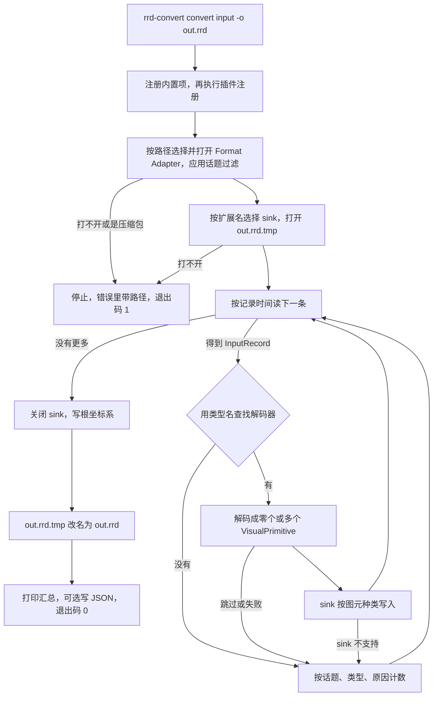

# 架构与实现约定

状态：开发依据，2026-11-02。代码尚未开始。按本文的代码框架和执行流程实现。不要改成按话题名分发，也不要让解码器直接调用某个可视化 SDK。

## 流水线

```text
Format Adapter      存储 → InputRecord
    → Decoder       InputRecord → VisualPrimitive，按消息类型名注册
    → Sink          VisualPrimitive → 一个可视化引擎，按引擎名注册
```

跨层只有这两种记录。

- `InputRecord` 对每种存储都一样，载荷保持序列化后的原样。`.db3` 适配器和以后的自定义适配器都停在这条记录上。
- `VisualPrimitive` 与引擎无关，只描述几何、图像、文本和坐标关系。它不含实体路径、不含 ROS 类型，也不含原始 bag 字节。Rerun sink 以及以后的 Foxglove、socket、自定义 sink 都从这里开始。

主循环只做三次查找：

1. 按输入路径选择 Format Adapter，产出 `InputRecord`。
2. 用记录里的类型名选择 Decoder，返回零个或多个 `VisualPrimitive`。
3. 本次选中的唯一一个 Sink 接收全部图元，在 Sink 内部按图元种类分派。

话题名不决定走哪段代码。没有对应解码器的类型跳过并计数，不中断转换。

## v1 实现范围

- Format Adapter：标准 ROS 2 SQLite 存储。输入可以是单个 `.db3`，也可以是 `ros2 bag record` 产出的 bag 目录（含 `metadata.yaml` 和多个分片）。压缩的 bag 明确报错，不尝试读取。
- Sink：Rerun `.rrd`，save 模式，Rerun C++ SDK 固定为 0.28.2。
- 话题过滤：`--topics` 和 `--exclude-topics`。
- 通用 CDR 读取：按 bag 内嵌的消息定义，或用户用 `--msg-path` 提供的 `.msg` 目录，解析任意自定义消息。插件作者只写「字段到图元」的映射。
- 内置 Decoder：

| 消息类型 | 处理 |
|----------|------|
| `sensor_msgs/msg/Image` | 编码见下文；深度编码写成深度图 |
| `sensor_msgs/msg/CompressedImage` | `format` 含 jpeg / png 时作为编码图像；含 h264 / h265 时作为视频帧；其它（如 compressedDepth）跳过并计数 |
| `foxglove_msgs/msg/CompressedVideo` | `format` 为 h264 / h265 时作为视频帧 |
| `sensor_msgs/msg/PointCloud2` | 着色规则见下文 |
| `tf2_msgs/msg/TFMessage` | 每个变换一个坐标变换图元；话题为 `/tf_static` 时标为静态 |
| `visualization_msgs/msg/Marker` | 类型和动作见下文 |
| `visualization_msgs/msg/MarkerArray` | 逐个按 Marker 处理 |

Foxglove、socket 流和自定义引擎在 v1 只有接口，没有第二个 sink 实现。

### 消息细节

图像编码：`rgb8`、`rgba8`、`bgr8`、`bgra8`、`mono8`、`mono16`、`16UC1`、`32FC1`、`nv12`、`yuv422_yuy2`。`16UC1` 和 `32FC1` 作为深度图。其它编码跳过，原因记为「不支持的图像编码」。

视频帧：H.264 / H.265 Annex B 码流原样写入，不转码。每个话题在第一个关键帧之前的帧跳过并计数。Viewer 端的限制写进用户文档：需要 FFmpeg 5.1 或更高版本；不支持 B 帧。Ubuntu 20.04 软件源里的 FFmpeg 是 4.2，用户需要另装。

点云：要求 `x`、`y`、`z` 为 float32。有 `rgb` 或 `rgba` 字段时用它着色；否则有 `intensity` 时按单条消息内的强度范围映射到固定色表；都没有时不带颜色，由引擎使用默认色。

Marker 类型：ARROW、CUBE、SPHERE、CYLINDER、LINE_STRIP、LINE_LIST、POINTS、CUBE_LIST、SPHERE_LIST、TEXT_VIEW_FACING。TRIANGLE_LIST 和 MESH_RESOURCE 跳过并计数。

Marker 动作：ADD / MODIFY 写入；DELETE 产出针对该 `ns/id` 的清除图元；DELETEALL 产出针对整个话题的递归清除图元。v1 不模拟 `lifetime` 到期，也不处理 `frame_locked`。

## 中间表示

### InputRecord

```text
topic          话题名
type_name      消息类型名，如 sensor_msgs/msg/Image
serialization  序列化名称，如 cdr
log_time_ns    存储里的记录时间，必有
bytes          载荷原样字节
```

消息头时间不在这里提取，由 Decoder 解析载荷后放进图元。

### VisualPrimitive

每个图元都带公共字段，再加一种载荷：

```text
topic            来源话题
frame_id         坐标系名；空表示未知
instance         同一话题下的子实例键，可选，例如 Marker 的 ns/id
log_time_ns      记录时间，必有
capture_time_ns  消息头时间，可选；为 0 时视为没有
payload          下列种类之一
```

| 种类 | 内容 |
|------|------|
| `Image` | 宽、高、编码、行跨度、像素字节 |
| `EncodedImage` | JPEG / PNG 字节和格式 |
| `VideoFrame` | 编解码器（H.264 / H.265）、Annex B 字节、是否关键帧 |
| `Points3D` | 位置、可选颜色、可选半径 |
| `LineStrips3D` | 若干条折线，可选颜色和线宽 |
| `Shapes3D` | 立方体、椭球或圆柱：中心、半尺寸、旋转、颜色 |
| `Arrows3D` | 起点、向量、颜色 |
| `TextLabels3D` | 位置和文字 |
| `Transform` | 父坐标系、子坐标系、平移、四元数（xyzw）、是否静态 |
| `Scalars` | 一组带名字的数值，用于时序曲线 |
| `Text` | 日志条目（带级别）或整段文本文档 |
| `Clear` | 清除本话题的某个 `instance`，或递归清除整个话题 |
| `Extension` | 种类名加任意载荷，供插件自定义 |

单位是米。颜色是 RGBA8。

内置种类用 `std::variant`。插件新增的种类走 `Extension`，不需要修改 variant。Sink 遇到不认识的 `Extension` 时跳过并计数，原因记为「sink 不支持该图元」。

## 接口

```text
FormatAdapter
  open(input path, topic filter) -> Status
  topics() -> topic name, type name, serialization
  message_definition(type name) -> 可选的消息定义文本
  next(InputRecord*) -> 有记录 / 读完 / 错误

Decoder
  type_name() -> string
  decode(const InputRecord&, DecodeContext&) -> DecodeResult
    DecodeResult: 图元列表；或「跳过 + 原因」；或「失败 + 原因」
    DecodeContext: 通用 CDR 读取入口，按类型名取得消息结构

Sink
  name() -> string
  open(output path, SinkOptions) -> Status
  write(const VisualPrimitive&) -> Status
  close() -> Status

Registry（存工厂，不存实例）
  add_adapter(format id, matches(path), factory)
  add_decoder(type name, factory)
  add_sink(name, output extension, factory)
```

- 适配器按 `matches(path)` 选择，第一个匹配的生效。v1 只有一个适配器。
- Sink 按输出文件扩展名选择，`.rrd` 对应 `rerun`。
- 每次转换由工厂新建适配器、解码器和 sink 实例。v1.1 的批处理可以并行地各建一套。
- 打开 bag 或打开输出失败时返回带路径和原因的 `Status`，`app` 据此停止并设置退出码。单条消息失败只计数，不停止。

## 读包

使用系统的 `libsqlite3`。不链接 `rclcpp`、`rosbag2_cpp`、由发行版生成的消息包，也不需要 `ament` 或已 source 的 ROS 工作区。

- 输入是文件时只读这一个 `.db3`。
- 输入是目录时读取其中全部 `.db3` 分片，按全局记录时间合并：每个分片各开一条按时间排序的查询，归并输出。各分片的话题 id 不同，统一按话题名对齐。
- 目录中出现 `.zstd` 文件，或 `metadata.yaml` 里的 `compression_format` 非空时，报错并说明暂不支持压缩包。`metadata.yaml` 只按行读取这一个键，不引入 YAML 库。
- 话题过滤在 SQL 查询里按话题 id 生效，被过滤的消息不会被读出。
- 消息定义优先取自 bag 内嵌的定义表，其次取自 `--msg-path`。两处都没有时，自定义类型的通用解码失败并计数；内置类型不受影响，因为它们使用手写的 CDR 读取。
- 载荷开头的 CDR 封装头不认识时，该条失败，原因记为「未知封装」。

## 通用 CDR

`cdr` 库提供两层：

1. `CdrReader`：按对齐规则读取基本类型、字符串、序列。内置 Decoder 直接使用。
2. 消息结构与动态读取：解析 ROS 2 `.msg` 文本（基本类型、字符串、定长 / 有界 / 不定长数组、嵌套类型；常量跳过），得到消息结构；再按结构把载荷读成可按字段路径访问的动态消息，如 `pose.position.x`。

bag 内嵌的定义可能是 `ros2msg` 或 `ros2idl` 编码。v1 只支持 `ros2msg`，`ros2idl` 失败并计数。`--msg-path` 下的目录按 `<package>/msg/<Type>.msg` 查找，依赖的类型也需要在这些目录中。

## Rerun sink

固定版本：Rerun C++ SDK 0.28.2。Viewer 能打开同一个小版本和下一个小版本写出的 `.rrd`，因此用户需要 0.28.x 或 0.29.x 的 Viewer。用户文档给出 `pip install rerun-sdk==0.28.2`。升级 SDK 是一次单独的变更，需要同步更新文档和发布包。

| 内容 | 写法 |
|------|------|
| 时间线 | `log_time` 每条都写；`capture_time` 只在有消息头时间时写 |
| 实体路径 | 默认等于话题名；有 `instance` 时为 `<话题>/<instance>` |
| 坐标系 | 带 `frame_id` 的图元同时写 `CoordinateFrame` |
| 坐标变换 | 写到固定实体 `/tf/<子坐标系>`，带父、子坐标系名；静态变换用静态写入 |
| 根坐标系 | `--root-frame` 指定；不指定时取只做过父、没做过子的坐标系中出现次数最多的那个。结束时在 `/` 上静态写入该坐标系 |
| 图像 | `Image`；深度编码写成 `DepthImage` |
| 视频 | `VideoStream`，编解码器按帧里的值 |
| 形状 | 立方体 `Boxes3D`、椭球 `Ellipsoids3D`、圆柱 `Cylinders3D` |
| 清除 | `Clear`，整个话题时递归 |

Rerun 不允许同一对坐标系的关系先写在一个实体上、再写到另一个实体上，所以坐标变换必须固定按子坐标系落实体，不能跟随来源话题。

## 命令行与退出

```text
rrd-convert convert <bag 目录 | file.db3> -o <out.rrd>
  [--topics a,b] [--exclude-topics c,d]
  [--root-frame map]
  [--msg-path DIR]...
  [--summary-json PATH]
```

- 先写 `<out.rrd>.tmp`，成功关闭后改名为 `<out.rrd>`。失败时删除临时文件，不留下半截结果。
- 结束时在标准错误打印汇总：每个「话题、类型、原因」的成功数、跳过数和失败数。`--summary-json` 把同样的内容写成 JSON，供 CI 解析。
- 退出码：`0` 转换完成，可能有跳过或单条失败；`1` 输入或输出失败，没有产出文件；`2` 命令行用法错误。

命令行由 `app` 手写解析，不引入命令行库。

## 代码框架

```text
rrd-convert（可执行文件）
  └── app             装配内置项、convert 主循环、命令行、run_cli 入口
        ├── format_db3      → core，libsqlite3
        ├── decode_builtin  → core，cdr
        ├── sink_rerun      → core，Rerun C++ SDK
        └── core            → 标准库
cdr                 → 标准库
```

| 目标 | 允许依赖 | 内容 |
|------|----------|------|
| `core` | 标准库 | 两种记录、`Status`、三个接口、注册表、转换汇总 |
| `cdr` | 标准库 | `CdrReader`、`.msg` 解析、动态消息 |
| `format_db3` | `core`、`libsqlite3` | `Ros2Db3Adapter`、分片归并、话题过滤 |
| `decode_builtin` | `core`、`cdr` | 内置 Decoder |
| `sink_rerun` | `core`、Rerun SDK | `RerunSink` |
| `app` | 以上全部 | `register_builtins()`、`run_convert()`、`run_cli()` |
| `rrd-convert` | `app` | 只有 `main`，调用 `run_cli` |

- `core` 和 `cdr` 不依赖任何第三方库。`decode_builtin` 不包含 Rerun 或 SQLite 头文件。`format_db3` 不包含解码或 sink 头文件。`sink_rerun` 不包含 SQLite 或 CDR 头文件。
- 内置项的注册只在 `app` 里做。
- 命名空间是 `rrd_convert`。

```text
CMakeLists.txt
cmake/rrd_convertConfig.cmake.in
src/core/status.hpp
src/core/input_record.hpp
src/core/visual_primitive.hpp
src/core/format_adapter.hpp
src/core/decoder.hpp
src/core/sink.hpp
src/core/registry.hpp
src/core/registry.cpp
src/core/conversion_summary.hpp
src/core/conversion_summary.cpp
src/cdr/cdr_reader.hpp
src/cdr/cdr_reader.cpp
src/cdr/msg_schema.hpp
src/cdr/msg_schema.cpp
src/cdr/dynamic_message.hpp
src/cdr/dynamic_message.cpp
src/format/ros2_db3_adapter.hpp
src/format/ros2_db3_adapter.cpp
src/decode/image_decoders.cpp
src/decode/point_cloud_decoder.cpp
src/decode/tf_decoder.cpp
src/decode/marker_decoder.cpp
src/decode/register_decoders.hpp
src/sink/rerun_sink.hpp
src/sink/rerun_sink.cpp
src/app/run_cli.hpp
src/app/run_cli.cpp
src/app/convert_app.hpp
src/app/convert_app.cpp
src/app/register_builtins.cpp
src/main.cpp
tests/cdr_writer.hpp
tests/make_fixture_bag.cpp
tests/cdr_reader_test.cpp
tests/msg_schema_test.cpp
tests/db3_adapter_test.cpp
tests/decoders_test.cpp
tests/convert_test.cpp
examples/custom_decoder/CMakeLists.txt
examples/custom_decoder/main.cpp
```

## 插件

v1 的插件是静态注册，不做动态库加载。

- 本项目安装一个 CMake 包：`find_package(rrd_convert)` 后可链接 `rrd_convert::app`。
- 插件作者在自己的仓库里写一个可执行文件，调用 `rrd_convert::run_cli(argc, argv, register_fn)`。`register_fn` 在内置项之后执行，用于注册自己的 Decoder、适配器或 sink。
- 自定义消息优先通过 `DecodeContext` 取得动态消息，只写字段到图元的映射。
- `examples/custom_decoder` 用一个自定义消息演示以上全部，并作为最小插件文档的代码。

## 构建与测试

- C++17，CMake 3.16 起，gcc 9 起。首个目标平台为 Ubuntu 20.04 x86_64。
- Rerun C++ SDK 0.28.2：本机已有则 `find_package`，否则用 CMake `FetchContent` 按固定版本下载。它会同时下载并编译 Arrow C++，从源码首次构建较慢。
- `libsqlite3` 用系统库。
- GoogleTest 用 `FetchContent` 引入，仅在构建测试时下载。
- 测试夹具由 `tests/make_fixture_bag` 生成：用测试专用的 CDR 写出器和 SQLite 写一份合成 bag，只含内置类型和一个示例自定义类型。合成夹具与读取器可能有相同的理解错误，所以实现后需要用真实录包在本地调试；真实录包不进仓库。
- 命名和格式按 Google C++ Style：类型 `CamelCase`，函数和变量 `snake_case`，私有成员尾部下划线，常量 `kCamelCase`，缩进 2 空格。
- 注释、日志和错误信息用英文。

## 发布

通过 GitHub Releases 发布预编译包，先覆盖 Ubuntu 20.04 x86_64。包内含 `rrd-convert` 可执行文件，以及供插件作者使用的头文件、静态库和 CMake 包。用户文档写明配套的 Viewer 版本和 FFmpeg 要求。

## 执行流程

打开 bag 或打开输出失败时停止，错误信息带路径，退出码为 1。单条消息没有解码器、被跳过或解码失败时，按「话题、类型、原因」计数后继续。



## 明确不做

- 转换前必须提供话题清单
- 按话题名选择解码器，或在主循环里写一串 `can_handle`
- 视频转码、厂商雷达 SDK、相机投影叠加、仪表盘
- 读取压缩的 bag
- v1 内建第二个 sink，或一次命令写多个 sink
- 把原始 bag 字节旁路写到另一个文件
- v1 做 `inspect`、时间裁剪或一次转换多个 bag 的批处理命令
- `ament`、已 source 的 ROS 工作区、私有消息包

## 曾比较过的做法

| 做法 | 不采用的原因 |
|------|----------------|
| 链接 `rosbag2_cpp` 和生成的 `sensor_msgs` | 解码最短，但核心路径会依赖某个 ROS 2 发行版 |
| 按话题名注册解码器，并在主循环里手写分支 | 每加一种消息都要改主循环 |
| 所有图元都用 `std::any` | 内置集合是闭合的，测试和阅读成本更高。内置用 variant，插件用 `Extension` |
| 图元里直接带实体路径 | 实体路径是 Rerun 的概念，会让中间层绑定 Rerun |
| 一条时间线混用消息头时间和记录时间 | 仿真时间或时间戳为 0 的消息会乱序 |
| 先转 MCAP 再交给 Viewer 自带的映射 | 少写标准解码器，但 Marker 不显示，自定义消息只有字段反射，也无法更换可视化引擎 |
| 在转换时把 H.265 转成 H.264 | 需要引入 FFmpeg 库依赖；固定的 Viewer 版本已能直接播放 H.265 |

## 实现顺序

按这个顺序做，做完一步再进入下一步。

1. CMake 骨架、`core`、GoogleTest；`convert` 的参数解析和退出码。
2. `CdrReader`、测试用 CDR 写出器及单元测试。
3. `.db3` 适配器：单文件、目录与分片归并、话题过滤、压缩包报错、读取内嵌消息定义。同时完成 `make_fixture_bag`。
4. 主循环、转换汇总、临时文件改名。
5. Rerun sink 的最小路径：两条时间线、实体路径、坐标系、坐标变换、根坐标系。配合 Image、PointCloud2、TFMessage 三个解码器，跑通第一个能用 Viewer 看到图像、点云和坐标系的 `.rrd`。
6. 其余内置解码器：CompressedImage（含视频）、CompressedVideo、Marker、MarkerArray，以及清除图元。
7. 通用 CDR：`.msg` 解析、动态消息、`--msg-path`。
8. 导出 CMake 包、`run_cli`、`examples/custom_decoder`。
9. 用真实录包本地调试，修正读取和解码问题。
10. Ubuntu 20.04 x86_64 预编译包。发布流程如果要新增 CI 配置，先确认再改。
11. 默认布局。先确认 0.28.2 的 C++ SDK 能否写 blueprint；不能则保留 Viewer 的自动布局。这一步失败不回退前面的转换路径。

许可证、Foxglove、socket、MCAP 输入都不在这个顺序里。
